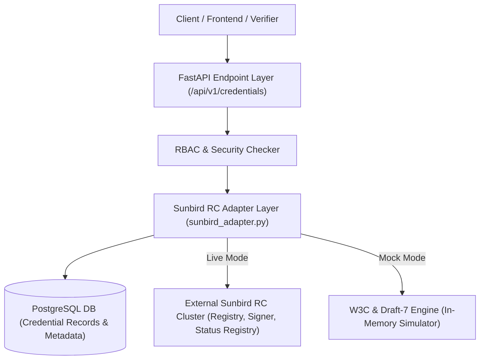

# Sunbird RC Integration Architecture & Specification Guide

This document describes the integration between the **AI-Powered Credential Platform** and **Sunbird RC** (the open-source electronic registry and credentialing platform), implemented in **Phase 3**.

---

## 1. Architectural Overview

To keep the integration clean, maintainable, and decoupled from business logic:
- All communications with Sunbird RC are routed through the dedicated **[`SunbirdRCAdapter`](file:///c:/Users/siddh/OneDrive/Desktop/AI-CREDENTIAL/backend/app/services/sunbird_adapter.py)** service.
- The adapter supports two verified operating modes configured via environment variables:
  1. **Development & Simulated Mode (`USE_MOCK_SUNBIRD=True`)**: Implements an in-memory Sunbird RC engine that generates fully compliant W3C Verifiable Credentials with Ed25519 cryptographic signatures, tracks revocation status in an active status registry, and executes JSON Schema Draft-7 validations.
  2. **Live Production Mode (`USE_MOCK_SUNBIRD=False`)**: Direct HTTP client communicating with an external Sunbird RC instance using official REST APIs.



---

## 2. Implemented Operations & Official Sunbird RC APIs

### Operation 1: Registry Setup & Credential Schema Configuration
- **Official Sunbird RC Endpoint**: `POST /api/v1/schemas` & `GET /api/v1/schemas/{id}`
- **Application Endpoint**: `POST /api/v1/credentials/schemas` (ADMIN only)
- **Workflow**:
  1. Validates that the input schema is syntactically compliant with **JSON Schema Draft-7** using `Draft7Validator`.
  2. Submits the schema definition and W3C credential template to Sunbird RC.
  3. Stores the registered schema reference (`sunbird_schema_id`, version, JSON schema) in PostgreSQL `credential_schemas` table.

```json
{
  "schema_name": "University Degree Certificate",
  "sunbird_schema_id": "UniversityDegreeSchema_v1",
  "version": "1.0.0",
  "json_schema": {
    "type": "object",
    "properties": {
      "degree_title": {"type": "string"},
      "major": {"type": "string"},
      "graduation_year": {"type": "integer"},
      "gpa": {"type": "number"}
    },
    "required": ["degree_title", "major", "graduation_year", "gpa"]
  }
}
```

---

### Operation 2: Credential Issuance
- **Official Sunbird RC Endpoint**: `POST /api/v1/{entity_name}`
- **Application Endpoint**: `POST /api/v1/credentials/issue` (ISSUER & ADMIN)
- **Workflow**:
  1. Pre-issuance validation: Validates recipient subject fields against the entity's registered JSON Schema.
  2. Invokes Sunbird RC adapter to mint a W3C-standard Verifiable Credential.
  3. Returns a unique Sunbird OSID (`sunbird_osid`) and the signed payload.

#### W3C Verifiable Credential Format Produced:
```json
{
  "@context": [
    "https://www.w3.org/2018/credentials/v1",
    "https://sunbirdrc.github.io/context/v1/context.json"
  ],
  "id": "urn:uuid:6c3e981f-829d-4bd9-8588-444747db5d9c",
  "type": ["VerifiableCredential", "University Degree Certificate"],
  "issuer": "did:sunbirdrc:enterprise-issuer-001",
  "issuanceDate": "2026-10-30T15:40:00Z",
  "credentialSubject": {
    "sunbird_osid": "osid-sb-44b20756e18f",
    "recipient_identifier": "alice.johnson@university.edu",
    "recipient_name": "Alice Johnson",
    "degree_title": "Bachelor of Science",
    "major": "Computer Science",
    "graduation_year": 2024,
    "gpa": 3.85
  },
  "proof": {
    "type": "Ed25519Signature2020",
    "created": "2026-10-30T15:40:00Z",
    "verificationMethod": "did:sunbirdrc:enterprise-issuer-001#key-1",
    "proofPurpose": "assertionMethod",
    "jws": "eyJhbGciOiJFZERTQSI...mock_signature_44b20756"
  }
}
```

---

### Operation 3: Storage of Credential References and Metadata
- **Storage Target**: PostgreSQL Database (`credential_records` table)
- **Stored Attributes**:
  - `id`: Internal unique primary key.
  - `sunbird_osid`: Unique Sunbird RC entity OSID reference (indexed).
  - `schema_id`: Foreign key reference to `credential_schemas.id`.
  - `recipient_identifier`: Indexed email / recipient ID (used for EMPLOYEE access scoping).
  - `recipient_name`: Recipient full name.
  - `status`: Lifecycle state (`ISSUED`, `REVOKED`, etc.).
  - `issued_by`: Foreign key to `users.id` (auditable issuer identity).
  - `issue_date`: Timestamp of issuance.
  - `revocation_reason`: Revocation rationale (if revoked).
  - `credential_payload`: Full immutable JSON-LD W3C Verifiable Credential.

---

### Operation 4: Credential Verification
- **Official Sunbird RC Endpoint**: `POST /api/v1/{entity_name}/verify`
- **Application Endpoint**: `POST /api/v1/credentials/verify` (VERIFIER, ISSUER, ADMIN, AUDITOR)
- **Supported Inputs**:
  - Direct **W3C VC JSON Payload** (`credential_payload`), OR
  - **Sunbird OSID reference** (`sunbird_osid`), which auto-retrieves the payload.
- **Verification Checks**:
  1. **Structure Check**: `@context`, `id`, `type`, `issuer`, `issuanceDate`, `credentialSubject`.
  2. **Cryptographic Proof Check**: `proof.type`, `proof.verificationMethod`, `proof.jws`.
  3. **Registry Revocation Check**: Confirms the credential has not been marked as `REVOKED` in the Sunbird RC Status Registry.

---

### Operation 5: Credential Revocation
- **Official Sunbird RC Endpoint**: `PUT /api/v1/{entity_name}/{osid}`
- **Application Endpoint**: `POST /api/v1/credentials/revoke` (ISSUER & ADMIN)
- **Workflow**:
  1. Verifies that the credential OSID exists in the system.
  2. Marks the entity as `REVOKED` in Sunbird RC with reason and timestamp.
  3. Updates PostgreSQL record: `status = "REVOKED"` and sets `revocation_reason`.
  4. Subsequent verification calls for this credential or OSID report `is_valid: false` and `status: "REVOKED"`.

---

## 3. Configuration & Deployment

### Environment Variables (`backend/.env`):
```ini
# Sunbird RC Service Base URL (Default for local Sunbird RC stack is port 8080)
SUNBIRD_RC_BASE_URL=http://localhost:8080

# Sunbird RC API Key (Bearer token if authentication proxy is enabled)
SUNBIRD_RC_API_KEY=demo-key

# Operational Mode: True = In-memory mock/dev engine; False = Live Sunbird RC instance
USE_MOCK_SUNBIRD=True
```

### Live Sunbird RC Deployment Requirements:
To run against a live Sunbird RC cluster:
1. Deploy Sunbird RC stack using standard Docker Compose:
   ```bash
   git clone https://github.com/sunbird-rc/sunbird-rc-core.git
   cd sunbird-rc-core/docker-compose
   docker-compose up -d
   ```
2. Set `USE_MOCK_SUNBIRD=False` in `backend/.env`.
3. Set `SUNBIRD_RC_BASE_URL=http://localhost:8080` (or your cluster host).

---

## 4. Test Suite Execution

Run the complete Sunbird RC integration test suite:

```powershell
cd backend
python -m unittest tests/test_sunbird_integration.py
```

Run all system test suites (Auth, RBAC, and Sunbird RC):

```powershell
cd backend
python -m unittest discover tests
```
